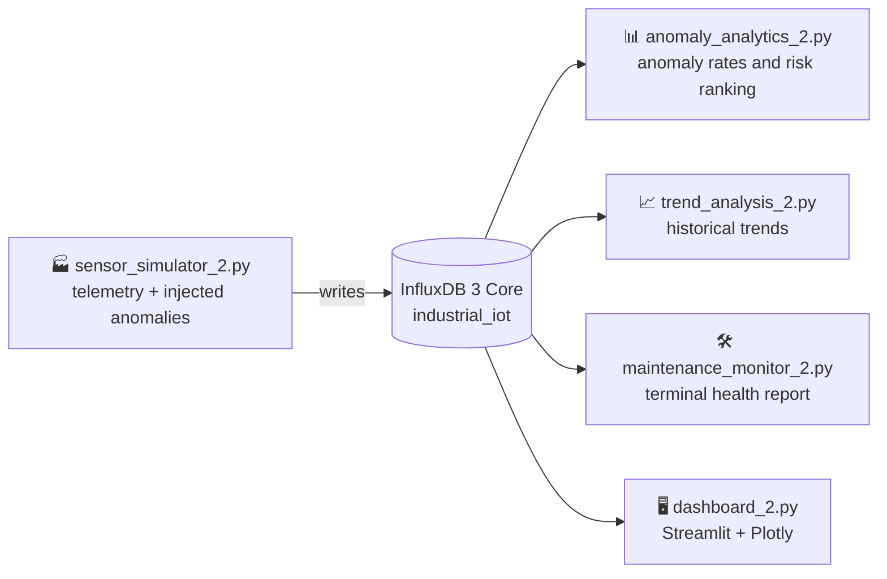

<div align="center">

<picture>
  <source media="(prefers-color-scheme: dark)" srcset="./assets/banner-dark.svg">
  <source media="(prefers-color-scheme: light)" srcset="./assets/banner-light.svg">
  
</picture>

<br/>


<p>
<b>Monitor machines in real time. Catch failures before they happen.</b><br/>
Simulated sensor telemetry &rarr; time-series storage &rarr; anomaly analytics &rarr; live health dashboard.
</p>

<a href="#-quick-start">Quick start</a> &nbsp;·&nbsp;
<a href="#-architecture">Architecture</a> &nbsp;·&nbsp;
<a href="#-health-classification">Health rules</a> &nbsp;·&nbsp;
<a href="#-team">Team</a>

</div>

<br/>

## ✨ Highlights

<table>
<tr>
<td width="33%" valign="top">

### 🏭 Live telemetry
Simulates motors, pumps and compressors streaming **temperature, vibration, pressure and RPM**, with anomalies injected to mimic failing equipment.

</td>
<td width="33%" valign="top">

### 📈 Anomaly analytics
Calculates **anomaly rates**, flags **threshold violations** and **ranks machines by risk** from historical sensor data.

</td>
<td width="33%" valign="top">

### 🖥️ Health dashboard
A real-time **Streamlit** dashboard with **Plotly** charts, live readings against safety thresholds and **maintenance recommendations**.

</td>
</tr>
</table>

## 🧭 Architecture



## 🚦 Health classification

Each machine is classified from its latest readings using these illustrative thresholds:

| Status | Condition | Meaning |
|:--|:--|:--|
| 🟢 **HEALTHY** | Below every threshold below | Normal operation |
| 🟡 **WARNING** | Temperature **&gt; 80 °C** *or* vibration **&gt; 7 mm/s** | Schedule an inspection |
| 🔴 **CRITICAL** | Temperature **&gt; 90 °C** *or* vibration **&gt; 9 mm/s** | Immediate attention needed |

## 🚀 Quick start

### 1. Start InfluxDB

Make sure your **InfluxDB 3 Core** instance is running locally at `http://localhost:8181`. The project uses a database named `industrial_iot`.

### 2. Install requirements

```bash
pip install influxdb-client-3 streamlit pandas plotly streamlit-autorefresh
```

### 3. Run the modules in order

Use a separate terminal for the simulator, since it runs continuously.

| Step | Command | What it does |
|:-:|:--|:--|
| **1** | `python sensor_simulator_2.py` | Generates live telemetry. Keep it running. |
| **2** | `python anomaly_analytics_2.py` | Evaluates anomaly rates and ranks machines by risk. |
| **3** | `python trend_analysis_2.py` | Analyzes historical sensor trends. |
| **4** | `python maintenance_monitor_2.py` | Prints a terminal-based health report. |
| **5** | `streamlit run dashboard_2.py` | Opens the interactive web dashboard. |

> [!TIP]
> Let the simulator run for a few minutes before step 2 so the analytics have enough history to work with.

<details>
<summary><b>Troubleshooting</b></summary>

<br/>

- **Connection errors:** check that InfluxDB 3 Core is running on `http://localhost:8181` and that the `industrial_iot` database exists.
- **Empty charts or reports:** the simulator must be running first so that data has been written.
- **Dashboard does not refresh:** make sure `streamlit-autorefresh` is installed.

</details>

## 🗂️ Project structure

```text
.
├── sensor_simulator_2.py      # Telemetry generator with anomaly injection
├── anomaly_analytics_2.py     # Anomaly rates, threshold violations, risk ranking
├── trend_analysis_2.py        # Historical trend analysis
├── maintenance_monitor_2.py   # Terminal health report and recommendations
└── dashboard_2.py             # Streamlit + Plotly web dashboard
```

## 👥 Team

| Member | Module | Scripts |
|:--|:--|:--|
| **Nirlep** | 🏭 Sensor simulation and data generation | `sensor_simulator_2.py` |
| **Abhijith** | 📊 Trend and anomaly analytics | `anomaly_analytics_2.py`, `trend_analysis_2.py` |
| **Rajneesh** | 🖥️ Maintenance monitoring and dashboard | `maintenance_monitor_2.py`, `dashboard_2.py` |

<div align="center">

<br/>

<sub>Built with Python, InfluxDB, Streamlit and a lot of coffee ☕</sub>

<picture>
  <source media="(prefers-color-scheme: dark)" srcset="./assets/footer-dark.svg">
  <source media="(prefers-color-scheme: light)" srcset="./assets/footer-light.svg">
  
</picture>

</div>
